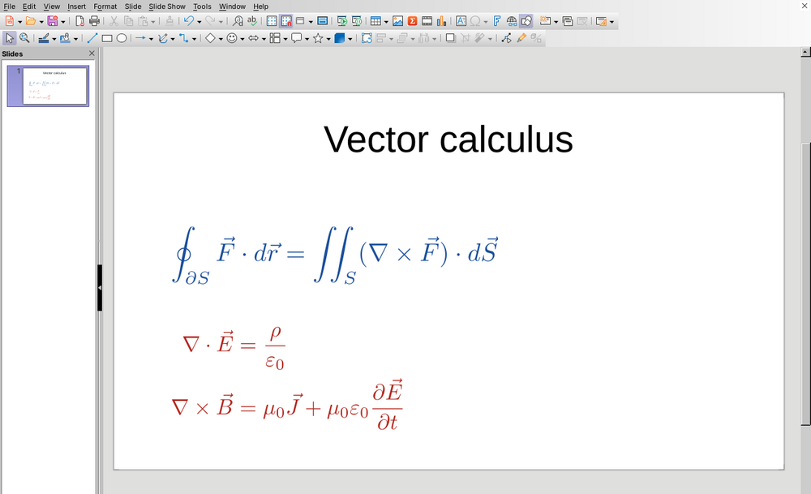
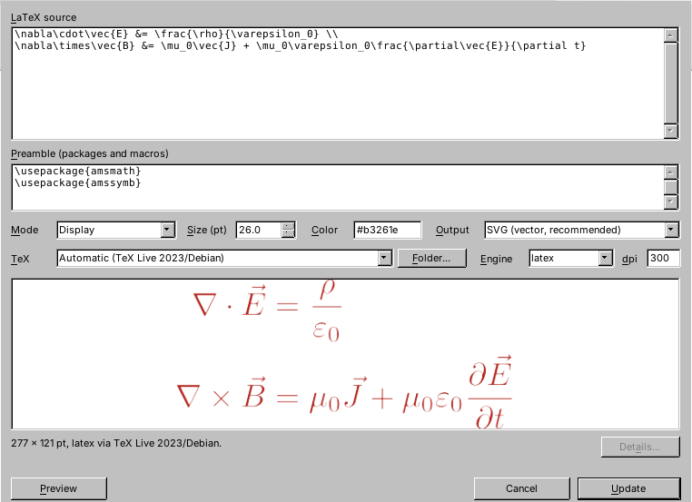
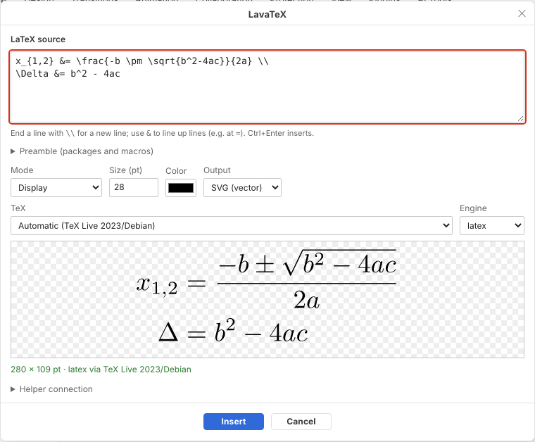

# LavaTeX

**Write once. Typeset everywhere.** LaTeX equations for LibreOffice Impress/Draw and the ONLYOFFICE Presentation Editor, inspired by IguanaTeX for PowerPoint.

LavaTeX turns LaTeX into an ordinary **SVG, PDF or PNG picture** using the TeX installation you already have (TeX Live, MiKTeX, MacTeX or Tectonic). The LaTeX source travels *inside* the picture and its alt text, so:

- **without LavaTeX**, the equation is just a crisp picture: it opens in any presentation format and any app (PPTX, ODP, PDF export, Keynote, Google Slides, ...);
- **with LavaTeX**, select the picture and edit its LaTeX again. Your scaling, position and rotation are kept.



**Guides:** [Installation](docs/installation.md) · [Usage](docs/usage.md) · [Troubleshooting](docs/installation.md#troubleshooting)

## Status

| Host | Package | State |
|---|---|---|
| LibreOffice Impress & Draw 7.0+ | `lavatex-libreoffice-<version>-multi.oxt` | Released in 0.1.0. Insert, edit and preview. Tested on LibreOffice 24.2 and 26.2 (Linux). |
| ONLYOFFICE Presentation Editor 8.3+ (editing needs 10.0+) | `lavatex-<platform>.zip`, then `lavatex setup onlyoffice` | Ready for the next release. Insert, edit and live preview, offline. Tested in ONLYOFFICE Desktop Editors 10.0, including editing equations made in LibreOffice (see [compatibility](docs/compatibility.md)). |
| PowerPoint | — | Planned: Office.js add-in reusing the ONLYOFFICE web UI and helper. |

## Quick start

1. **Have a TeX distribution.** If you can compile LaTeX in VS Code, you already do. Otherwise install [TeX Live](https://tug.org/texlive/), [MiKTeX](https://miktex.org/) or [MacTeX](https://tug.org/mactex/).
2. **Install LavaTeX** from the [releases page](https://github.com/LavakumarVeludandi/LavaTex/releases):
   - **LibreOffice:** download the `.oxt`, then *Tools › Extension Manager › Add…* and restart LibreOffice. Use *Insert › LaTeX Equation…* or the **Σ** toolbar button.
   - **ONLYOFFICE:** download `lavatex-<platform>.zip`, unzip it, and run `lavatex setup onlyoffice` once. It installs the plugin and a small helper that starts by itself. Restart ONLYOFFICE and use *Plugins › LavaTeX*.
3. **Edit** an equation later: select it and open LavaTeX again.

| LibreOffice | ONLYOFFICE |
|---|---|
|  |  |

### How it works

```
                 ┌──────────────────────── lavatex (Rust) ─────────────────────────┐
LaTeX source ──► │ find your TeX  →  sandboxed compile  →  SVG / PDF / PNG          │ ──► picture + source
                 │ (TeX Live, MiKTeX, MacTeX, Tectonic)    + embedded metadata      │
                 └──────────────────────────────────────────────────────────────────┘
                      ▲ CLI (stdin/stdout JSON)              ▲ lavatex-helper (localhost HTTP)
          LibreOffice extension (Python UNO)        ONLYOFFICE plugin (HTML/JS)
```

ONLYOFFICE plugins are web pages that may not start programs, so ONLYOFFICE talks to a small helper on your own computer, which `lavatex setup onlyoffice` installs and starts at login. LibreOffice runs `lavatex` directly. See [docs/design.md](docs/design.md).

## Writing equations

Type just the math, e.g. `\frac{a}{b}`; LavaTeX adds the document around it.

For **several lines**, end each line with `\\`. Lines are centred, or lined up at `&` if you use it:

```latex
f(x) &= (x+1)^2 \\
     &= x^2 + 2x + 1
```

As in LaTeX, a line break in the source without `\\` does not start a new line.

Habits from IguanaTeX and LaTeX work too:

- your own delimiters: `$…$` (inline), `\[…\]` or `$$…$$` (display);
- display environments: `equation`, `align`, `gather`, `multline` and their starred forms. On a slide these become `aligned`/`gathered`, with no equation numbers;
- several display blocks in a row (`\[…\]`, `align*`, …), which are stacked one above the other;
- a complete IguanaTeX-style document (`\documentclass … \begin{document} … \end{document}`). Its preamble is used, and the whole document is kept as the editable source.

## Command line

```console
$ lavatex render '\frac{-b \pm \sqrt{b^2-4ac}}{2a}' -f svg -s 24 -c '#1a4f9c' -o quadratic.svg
quadratic.svg (168.9 x 54.4 pt, latex via TeX Live 2023/Debian)
$ lavatex inspect quadratic.svg      # prints the embedded source and settings
$ lavatex render --request req.json --json -o out.pdf   # machine interface used by host plugins
```

## Repository layout

```
crates/lavatex-core     Rust library: TeX discovery, sandboxed rendering, metadata embed/extract
crates/lavatex-cli      `lavatex` (detect, render, inspect, config, setup, serve) and `lavatex-helper`
hosts/libreoffice       LibreOffice extension (Python UNO): dialog, insert/edit, packaging metadata
hosts/onlyoffice        ONLYOFFICE plugin (HTML/JS) + shared browser core (scripts/lavatex-core.js)
fixtures/metadata       Cross-language metadata fixture (Rust writes it; JS and Python must parse it)
docs/                   Installation and usage guides, design, metadata format, compatibility
tools/package.py        Builds dist/*.oxt and dist/*.plugin
```

## Development

```console
cargo test                                         # core unit tests (incl. shared fixture)
node --test hosts/onlyoffice/tests/core.test.js    # browser core
node hosts/onlyoffice/tests/e2e.js target/debug/lavatex   # plugin page + real helper (needs Playwright)
python3 hosts/libreoffice/tests/test_headless.py   # real LibreOffice: insert, edit, save ODP/PPTX, reopen
python3 tools/package.py all                       # build dist/ packages
```

## License

Apache License 2.0, see [LICENSE](LICENSE). LavaTeX contains no IguanaTeX code. The ONLYOFFICE plugin does not bundle ONLYOFFICE's plugin SDK. It uses the copy that ships with ONLYOFFICE, and falls back to ONLYOFFICE's site only if none is found.
