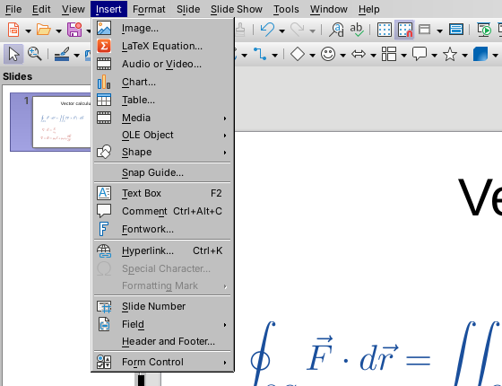
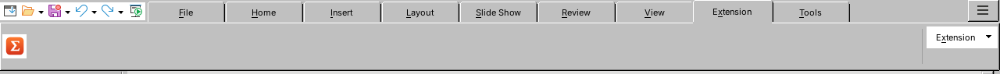
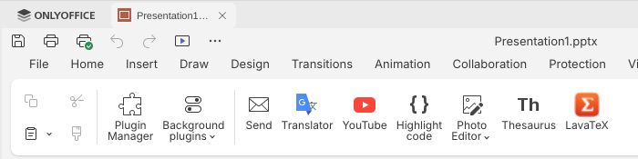
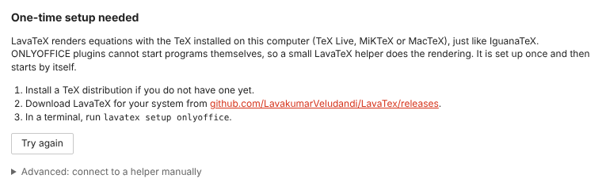

# Installing LavaTeX

LavaTeX needs two things: a **TeX distribution** (LavaTeX uses yours, just like IguanaTeX does) and the **LavaTeX package for your office suite**.

- [1. Install TeX](#1-install-tex)
- [2. LibreOffice Impress and Draw](#2-libreoffice-impress-and-draw)
- [3. ONLYOFFICE Presentation Editor](#3-onlyoffice-presentation-editor)
- [4. PowerPoint](#4-powerpoint)
- [Choosing a TeX installation, engine and format](#choosing-a-tex-installation-engine-and-format)
- [Uninstalling](#uninstalling)
- [Troubleshooting](#troubleshooting)

Downloads are on the [releases page](https://github.com/LavakumarVeludandi/LavaTex/releases):

| File | What it is |
|---|---|
| `lavatex-libreoffice-<version>-multi.oxt` | LibreOffice extension for every platform. **Use this one if unsure.** |
| `lavatex-libreoffice-<version>-<platform>.oxt` | Smaller LibreOffice extension for one platform. |
| `lavatex-<platform>.zip` | The `lavatex` program. Needed for ONLYOFFICE and PowerPoint, optional otherwise. |
| `lavatex-onlyoffice-<version>.plugin` | The ONLYOFFICE plugin on its own. You don't normally need it: `lavatex setup onlyoffice` installs the plugin for you. |

Platforms are `windows-x86_64`, `macos-aarch64` (Apple silicon), `macos-x86_64` (Intel), `linux-x86_64` and `linux-aarch64`.

## 1. Install TeX

If you already compile LaTeX documents (in VS Code, TeXstudio, Overleaf's desktop tools, …) you have TeX and can skip this step.

| System | Command or download |
|---|---|
| Fedora | `sudo dnf install texlive-scheme-medium texlive-dvisvgm` |
| Ubuntu, Debian | `sudo apt install texlive-latex-recommended texlive-latex-extra dvisvgm` |
| Arch | `sudo pacman -S texlive-basic texlive-latex texlive-latexrecommended texlive-binextra` |
| Windows | [MiKTeX](https://miktex.org/download) or [TeX Live](https://tug.org/texlive/windows.html) |
| macOS | [MacTeX](https://tug.org/mactex/) (or `brew install --cask mactex-no-gui`) |
| Anywhere | [Tectonic](https://tectonic-typesetting.github.io/) (a single program; downloads packages on first use) |

SVG output, the default, needs `latex` and `dvisvgm`; both are part of every full TeX Live and MiKTeX install. PNG output uses `dvipng` or Poppler's `pdftocairo`.

**MiKTeX users:** MiKTeX may want to download a missing package the first time it is used. If a render times out, open the MiKTeX Console and set *Settings › Always install missing packages on-the-fly*.

## 2. LibreOffice Impress and Draw

Needs LibreOffice 7.0 or newer. On Linux the distribution's LibreOffice must include Python scripting (Fedora: `libreoffice-pyuno`, Debian/Ubuntu: `libreoffice-script-provider-python`).

1. Download `lavatex-libreoffice-<version>-multi.oxt`.
2. In LibreOffice choose *Tools › Extension Manager…*, click **Add…** and pick the file (or simply double-click the `.oxt`).
3. Restart LibreOffice.

The extension contains the `lavatex` program for every platform, so nothing else needs installing.

After the restart LavaTeX appears in four places:

| Where | Look for |
|---|---|
| *Insert* menu | **LaTeX Equation…** |
| Standard toolbar | the **Σ** button, next to *Insert Image* |
| *Tools › Add-Ons* | **LaTeX Equation (LavaTeX)…** |
| Tabbed interface (*View › User Interface › Tabbed*) | **Extension** tab › **Σ** |





Continue with the [usage guide](usage.md).

## 3. ONLYOFFICE Presentation Editor

Needs ONLYOFFICE Desktop Editors 8.3 or newer; **10.0 or newer** to edit equations after inserting them.

ONLYOFFICE plugins are web pages and are not allowed to start programs such as `latex`. So LavaTeX for ONLYOFFICE comes with a small **helper** program that does the rendering. One command sets everything up, once:

1. Download `lavatex-<platform>.zip` for your system and unzip it. It contains `lavatex` and `lavatex-helper`.
2. Open a terminal in the unzipped folder and run:

   ```console
   ./lavatex setup onlyoffice          # Windows: .\lavatex.exe setup onlyoffice
   ```

   ```text
   Setting up LavaTeX for ONLYOFFICE…

     ✓ TeX found: TeX Live 2026 (/usr/local/texlive/2026/bin/x86_64-linux)
     ✓ Plugin installed for ONLYOFFICE Desktop Editors
         /home/you/.local/share/onlyoffice/desktopeditors/data/sdkjs-plugins/{6C1B2C4E-8D53-4F0A-9B7E-4A1E5D2F7C31}
     ✓ LavaTeX installed in /home/you/.local/share/lavatex/bin
     ✓ Helper starts in the background when you log in (running now)
     ✓ Helper is running and paired with the plugin

   Done. Restart ONLYOFFICE, open a presentation, and choose Plugins › LavaTeX.
   To remove everything again: lavatex setup onlyoffice --uninstall
   ```

3. Restart ONLYOFFICE, open a **presentation**, and click **LavaTeX** on the **Plugins** tab.



That's all. You can delete the unzipped folder afterwards; the setup copied the programs to a permanent place.

### What the setup does

| Step | Linux | macOS | Windows |
|---|---|---|---|
| Copies `lavatex` and `lavatex-helper` to | `~/.local/share/lavatex/bin` | `~/Library/Application Support/LavaTeX/bin` | `%LOCALAPPDATA%\Programs\LavaTeX` |
| Installs the plugin into ONLYOFFICE's user plugin folder | native, Flatpak and Snap installs | `~/Library/Application Support/asc.onlyoffice.ONLYOFFICE/data/sdkjs-plugins` | `%LOCALAPPDATA%\ONLYOFFICE\DesktopEditors\data\sdkjs-plugins` |
| Starts the helper at login | systemd user socket (the helper only runs while it's being used), or an autostart entry on systems without systemd | a LaunchAgent | a *Run* entry in the registry (no console window) |

It also writes a pairing file next to the plugin, so the plugin finds the helper and its access token by itself. Nothing is installed system-wide and no administrator rights are needed. The helper only accepts connections from this computer and only from programs that know the token.

Options:

```console
lavatex setup onlyoffice --plugins-dir <folder>   # ONLYOFFICE's sdkjs-plugins folder, if it isn't found automatically
lavatex setup onlyoffice --no-autostart           # don't start the helper at login; run `lavatex serve` yourself
lavatex setup onlyoffice --port 7355              # use another local port
```

Run the setup again at any time, for example after updating LavaTeX or ONLYOFFICE. It replaces the previous installation.

### If the plugin says "One-time setup needed"



The plugin couldn't reach the helper. Run `lavatex setup onlyoffice`, then click **Try again**. If the setup finished earlier, the helper might have been stopped: running the setup again restarts it.

### ONLYOFFICE Document Server (web)

The plugin works in Document Server too, but the helper has to run on each user's own computer, because that's where TeX is. Install the plugin on the server as usual, have each user run `lavatex serve` (or `lavatex setup onlyoffice --plugins-dir <any folder>` for autostart), and enter the helper's address and the output of `lavatex token` under **Advanced: connect to a helper manually** on the plugin's first screen. Document Server support is not tested yet.

## 4. PowerPoint

Needs **PowerPoint for Microsoft 365** on Windows or macOS, or PowerPoint for the web. One-time-purchase versions (PowerPoint 2019, 2021, 2024) may lack the add-in features LavaTeX needs (PowerPoint API 1.5); the LavaTeX pane tells you if yours is too old.

Like ONLYOFFICE plugins, PowerPoint add-ins are web pages that may not start programs, so LavaTeX for PowerPoint uses the same small **helper** to run TeX. PowerPoint only loads add-ins over HTTPS, so the helper also gets a certificate that is valid for this computer only. One command sets everything up, once:

1. Download `lavatex-<platform>.zip` for your system and unzip it.
2. Open a terminal in the unzipped folder and run:

   ```console
   .\lavatex.exe setup powerpoint      # macOS: ./lavatex setup powerpoint
   ```

   It prints something like:

   ```text
   Setting up LavaTeX for PowerPoint…

     ✓ TeX found: MiKTeX 24.1 (C:\Users\you\AppData\Local\Programs\MiKTeX\miktex\bin\x64)
     ✓ LavaTeX installed in C:\Users\you\AppData\Local\Programs\LavaTeX
     ✓ HTTPS certificate created (valid for this computer only)
     ✓ Certificate trusted for your Windows account
     ✓ Add-in registered with PowerPoint
         C:\Users\you\AppData\Local\Programs\LavaTeX\lavatex-powerpoint.xml
     ✓ Helper starts in the background when you log in to Windows (running now)
     ✓ Add-in is served at https://localhost:7355

   Done. Restart PowerPoint: the LavaTeX tab appears on the ribbon.
   ```

   **Windows asks you to confirm the certificate** ("You are about to install a certificate from a certification authority… LavaTeX local helper"): click **Yes**. On macOS you are asked for your password instead.
3. Restart PowerPoint. A **LavaTeX** tab appears on the ribbon:

   | Group | Button | What it does |
   |---|---|---|
   | Equation | **New Equation** | Opens the LavaTeX pane to type a new equation. |
   | | **Edit Equation** | Opens the pane with the selected equation's LaTeX. |
   | Selection | **Regenerate** | Renders the selected equations again from their LaTeX, for example after installing a package. |
   | LavaTeX | **Settings** | TeX installation, engine, output format and default preamble. |
   | | **Help** | Opens the user guide. |

If you already ran `lavatex setup onlyoffice`, the same helper serves both.

### What the setup does

| Step | Windows | macOS |
|---|---|---|
| Copies `lavatex` and `lavatex-helper` to | `%LOCALAPPDATA%\Programs\LavaTeX` | `~/Library/Application Support/LavaTeX/bin` |
| Creates an HTTPS certificate in | `%APPDATA%\LavaTeX\tls` | `~/Library/Application Support/LavaTeX/tls` |
| Trusts the certificate in | your account's *Trusted Root Certification Authorities* | your login keychain |
| Registers the add-in with | `HKCU\Software\Microsoft\Office\16.0\WEF\Developer` | `~/Library/Containers/com.microsoft.Powerpoint/Data/Documents/wef` |
| Starts the helper at login with | a *Run* entry in the registry | a LaunchAgent |

About the certificate: LavaTeX creates its own small certificate authority, **restricted to `localhost`**, so even if it were copied it could not be used to impersonate any other website. Its private key is deleted right after use. Run `lavatex setup powerpoint --new-certificate` to replace it, or `--uninstall` to remove it.

### PowerPoint for the web

On Linux (or anywhere you use PowerPoint in a browser), the setup creates the certificate and the add-in file but cannot register it with your Microsoft 365 account. In PowerPoint for the web, choose *Home › Add-ins › More Add-ins › My Add-ins › Upload My Add-in* and pick `lavatex-powerpoint.xml` from the folder the setup printed. On Linux the setup trusts the certificate for Chrome and Chromium when `certutil` (package `nss-tools` or `libnss3-tools`) is installed; for other browsers, import `ca.pem` from the LavaTeX config folder's `tls` folder as a certificate authority.

## Choosing a TeX installation, engine and format

LavaTeX picks a TeX installation automatically. To see what it found:

```console
$ lavatex detect
TeX Live 2026 (suggested)
  folder:  /usr/local/texlive/2026/bin/x86_64-linux
  engines: latex, pdflatex, xelatex, lualatex
  formats: svg, pdf, png
```

Both dialogs also have a **TeX** list to choose an installation and an **Engine** list. To set defaults for every host from the command line:

```console
lavatex config --toolchain "C:\texlive\2026\bin\windows"   # a folder containing latex
lavatex config --engine xelatex                            # latex, pdflatex, xelatex, lualatex or tectonic
lavatex config --format svg                                # svg, pdf or png
lavatex config                                             # show the current settings
```

Settings are stored in:

| OS | Folder |
|---|---|
| Linux | `~/.config/lavatex` (or `$XDG_CONFIG_HOME/lavatex`) |
| macOS | `~/Library/Application Support/LavaTeX` |
| Windows | `%APPDATA%\LavaTeX` |

That folder holds `config.json` (TeX, engine, format), `helper-token` and `libreoffice.json` (LibreOffice dialog defaults). Set `LAVATEX_CONFIG_DIR` to use another folder.

## Uninstalling

- **LibreOffice:** *Tools › Extension Manager*, select LavaTeX, **Remove**.
- **ONLYOFFICE:** run `lavatex setup onlyoffice --uninstall`. It removes the plugin, the autostart entry and the installed programs.
- **PowerPoint:** run `lavatex setup powerpoint --uninstall`. It unregisters the add-in and removes its certificate, the autostart entry and the installed programs.

If both ONLYOFFICE and PowerPoint are set up, uninstalling one keeps the helper for the other.

Equations you already inserted stay in your presentations as ordinary pictures.

## Troubleshooting

| Problem | What to do |
|---|---|
| "No TeX installation was found" | Install TeX (step 1). If it's installed in an unusual place, run `lavatex config --toolchain <folder containing latex>`. |
| "*name*.sty is not installed" | Install the package: `tlmgr install name` (TeX Live), the MiKTeX Console, or your distribution's package manager (Fedora: `sudo dnf install 'tex(name.sty)'`). Or remove it from the preamble. |
| Rendering times out | MiKTeX or Tectonic is probably waiting to download a package. Run `lavatex render 'x'` in a terminal to see what it is doing. |
| LibreOffice: no LavaTeX menu entries | Restart LibreOffice completely (also its quick starter). On Linux, check that LibreOffice's Python support is installed (see step 2). |
| LibreOffice: no PDF in the *Output* list | Your LibreOffice build can't display PDF pictures (Fedora's can't). Use SVG, which is just as sharp. |
| ONLYOFFICE: LavaTeX isn't on the Plugins tab | Make sure a **presentation** is open. Run `lavatex setup onlyoffice` again and restart ONLYOFFICE. If ONLYOFFICE is installed in an unusual way, pass `--plugins-dir`. |
| ONLYOFFICE: "One-time setup needed" or "helper not available" | Run `lavatex setup onlyoffice`, then click **Try again**. |
| ONLYOFFICE: equations can't be edited | Editing needs ONLYOFFICE 10.0 or newer. |
| PowerPoint: no LavaTeX tab | Close PowerPoint completely and start it again. If the tab still doesn't appear, run `lavatex setup powerpoint` again, close PowerPoint, delete the folder `%LOCALAPPDATA%\Microsoft\Office\16.0\Wef` (Office's add-in cache; Office recreates it) and start PowerPoint. |
| PowerPoint: "We can't load this add-in" or a blank pane | The helper isn't running or the certificate isn't trusted. Run `lavatex setup powerpoint` again (click **Yes** when Windows asks about the certificate). |
| PowerPoint 2019 or older on Windows: blank pane | Those versions show add-ins with an older browser engine that blocks `localhost`. Use PowerPoint for Microsoft 365. |
| PowerPoint: equations inserted but alt text missing | Older PowerPoint versions cannot set alt text from add-ins. The LaTeX source is stored in the picture's tags instead, and editing works. |
| Equation is no longer editable after converting the file | Some converters drop alt text. The picture may still carry its source: `lavatex inspect picture.svg`. |
