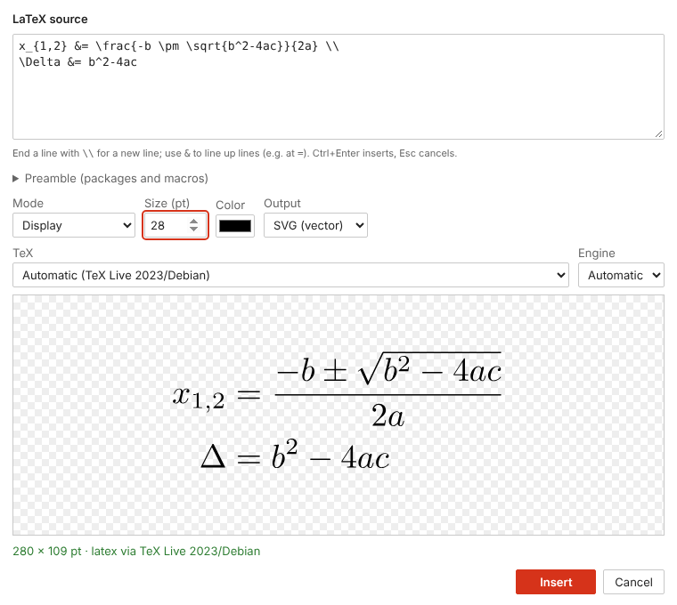
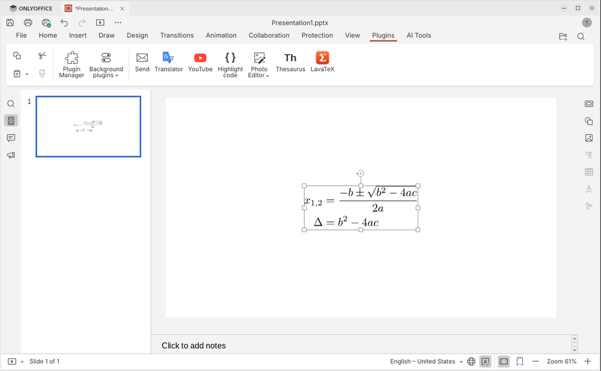

# Using LavaTeX

LavaTeX works the same way in LibreOffice, ONLYOFFICE and PowerPoint: type LaTeX, look at the preview, insert. The result is an ordinary picture on your slide that LavaTeX can edit again later.


- [Insert an equation](#insert-an-equation)
- [Edit an equation](#edit-an-equation)
- [Regenerate equations (PowerPoint)](#regenerate-equations-powerpoint)
- [Writing LaTeX](#writing-latex)
- [Dialog options](#dialog-options)
- [Sharing presentations](#sharing-presentations)
- [Command line](#command-line)

## Insert an equation

**LibreOffice Impress or Draw:** choose *Insert › LaTeX Equation…*, click the **Σ** toolbar button, or use the **Extension** tab in the Tabbed interface.


**ONLYOFFICE:** open the **Plugins** tab and click **LavaTeX**.


**PowerPoint:** on the **LavaTeX** tab, click **New Equation**. The LavaTeX editor opens in its own window; PowerPoint waits until you insert or cancel.



Then:

1. Type the formula into **LaTeX source**, for example `\frac{-b \pm \sqrt{b^2-4ac}}{2a}`. You don't need `$` signs or a document around it.
2. The preview updates as you type. Mistakes are shown under the preview, with the line they are on.
3. Click **Insert**, or press **Ctrl+Enter**. (In PowerPoint, **Esc** or **Cancel** closes the editor without inserting.)

The equation is placed in the middle of the slide. Move, resize and rotate it like any picture.



## Edit an equation

Select the equation and open LavaTeX the same way as for inserting (in PowerPoint: **Edit Equation** on the LavaTeX tab). The dialog opens with the equation's source and settings. Change it and click **Update** (LibreOffice, PowerPoint) or **Insert** (ONLYOFFICE).

The new picture replaces the old one at the same position, rotation and scale. If you had made the equation twice as big on the slide, the edited one is twice as big too, and a longer equation gets wider instead of being squeezed.

Editing works for equations made in any of the apps: an equation made in LibreOffice and saved as PPTX can be edited in PowerPoint or ONLYOFFICE, and the other way round. ONLYOFFICE needs version 10.0 or newer to edit.

## Regenerate equations (PowerPoint)

Select one or more equations and click **Regenerate** on the LavaTeX tab. Each one is rendered again from its own LaTeX, keeping its size, position and rotation, without opening the editor. Use this after installing a missing package, or to redo equations made on another computer with your TeX. Other selected objects are left alone.

## Writing LaTeX

### Single formulas

Type just the math:

```latex
\int_0^\infty e^{-x^2}\,dx = \frac{\sqrt{\pi}}{2}
```

`amsmath` is loaded automatically when you use its commands, so `\text`, `\dfrac`, `\begin{pmatrix}` etc. work straight away.

### Several lines

End each line with `\\`. Lines are centred:

```latex
a^2 + b^2 = c^2 \\
e^{i\pi} + 1 = 0
```

Add `&` to line the lines up at that point, usually before `=`:

```latex
f(x) &= (x+1)^2 \\
     &= x^2 + 2x + 1
```

As in LaTeX, pressing Enter without `\\` does **not** start a new line on the slide.

### Input from IguanaTeX and LaTeX documents

You can paste what you are used to:

| You type | LavaTeX uses |
|---|---|
| `$…$` or `\(…\)` | an inline (text-style) formula |
| `\[…\]` or `$$…$$` | a display formula |
| `equation`, `align`, `gather`, `multline` (also starred) | the same layout without equation numbers |
| several `\[…\]` or `align*` blocks in a row | the blocks stacked one above the other |
| a whole document, `\documentclass … \begin{document} … \end{document}` | its preamble and body; the whole document stays the editable source |

The last form is what IguanaTeX stores, so you can copy the source of an IguanaTeX equation from PowerPoint and paste it in.

### Packages and macros

Open **Preamble** in the dialog to add packages and your own commands, for example:

```latex
\usepackage{physics}
\newcommand{\R}{\mathbb{R}}
```

Any package installed in your TeX distribution can be used. The preamble is saved with each equation, so it is used again when you edit it, and the dialog remembers the last one you used for new equations. When you edit an equation whose preamble differs from yours, for example from someone else's file, LavaTeX points that out so you can review it.

## Dialog options

| Option | What it does |
|---|---|
| **Mode** | *Display* for stand-alone formulas (big fractions and sums), *Inline* for text-style formulas, *Text* for normal text, which can contain `$…$`. |
| **Size (pt)** | Font size of the equation. 20–32 pt suits most slides. |
| **Color** | Colour of the equation. |
| **Output** | *SVG* (sharp at any size; recommended), *PDF* (sharp; LibreOffice only, and only when your LibreOffice can show PDF pictures), or *PNG* (a picture at the chosen DPI, for apps that don't handle vector pictures). |
| **TeX** | Which TeX installation to use, if you have more than one. *Automatic* uses the one `lavatex detect` suggests. |
| **Engine** | `latex` (fastest, default), `pdflatex`, `xelatex` or `lualatex` (for system fonts and Unicode input, with `fontspec`), or `tectonic`. |

Your last choices are kept for the next equation. In PowerPoint, if your version cannot insert SVG pictures, LavaTeX inserts a PNG instead.

## Sharing presentations

Equations are ordinary pictures, so people **without LavaTeX** see them exactly as you do, in any app: LibreOffice, ONLYOFFICE, PowerPoint, Keynote, Google Slides, PDF export.

The LaTeX source is stored three times: in the picture file itself, in the picture's alt text, and in hidden shape properties (LibreOffice) or tags (PowerPoint). That is why it survives saving as ODP or PPTX and moving between apps. The alt text starts with the LaTeX source, which also helps screen-reader users.

Anyone who installs LavaTeX can edit your equations, using their own TeX installation.

## Command line

The `lavatex` program can also render equations without an office suite:

```console
$ lavatex render '\frac{-b \pm \sqrt{b^2-4ac}}{2a}' -f svg -s 24 -c '#1a4f9c' -o quadratic.svg
quadratic.svg (168.9 x 54.4 pt, latex via TeX Live 2026)
$ lavatex inspect quadratic.svg       # show the source stored in a picture
$ lavatex detect                      # list TeX installations
$ lavatex --help
```
